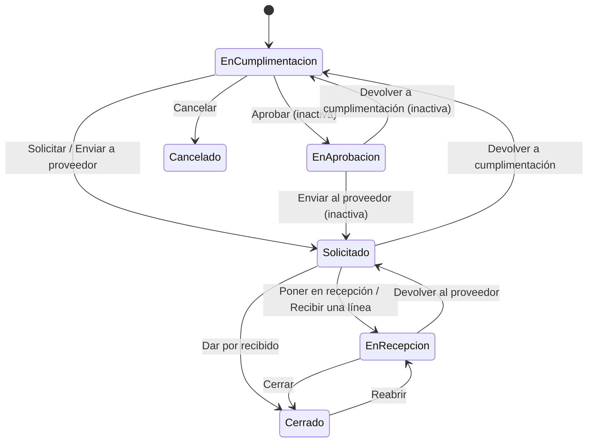

# Flujo del negocio 'Pedidos' para el tipo 'PED: General'

Un pedido es la compra de materiales o servicios a un proveedor. Lo cumplimenta quien necesita la compra, se solicita al proveedor (se emite y envía su pdf), se registran las entregas y se cierra. El estado inicial del tipo es **PED: En cumplimentación**.

Las transiciones marcadas **(manual)** las aplica el usuario desde el pedido. Las marcadas **(sistema)** las aplica el propio sistema como consecuencia de otra operación (un trabajo diario, una entrega...). Las marcadas **(inactiva)** están definidas pero dadas de baja: hoy no se pueden usar.

## Flujo

| Estado | Etapa | Observaciones |
|---|---|---|
| PED: En cumplimentación | `PED_Etapa_De_Cumplimentacion`, `PED_Etapa_De_Aprobacion` | Estado inicial. Se editan cabecera y líneas. |
| PED: En aprobación | `PED_Etapa_De_Aprobacion` | Dado de baja: ninguna transición activa llega hoy a él. |
| PED: Solicitado | `PED_Etapa_De_Solicitud` | Enviado al proveedor; aún sin entregas. |
| PED: En recepción | `PED_Etapa_De_Recepcion` | Con entregas registradas (o por registrar). |
| PED: Cerrado | `PED_Etapa_Cerrado` | Estado terminado: todo recibido. Admite devoluciones y reapertura. |
| PED: Devuelto | `PED_Etapa_Devuelto` | Definido como terminado, pero hoy ninguna transición llega a él. |
| PED: Cancelado | `PED_Etapa_Cancelado` | Estado final: el pedido ya no hace falta. |

## Transiciones

### PED: En cumplimentación ---> PED: Aprobar --> PED: En aprobación  (inactiva)
Estaba pensada para que un responsable validara el pedido antes de enviarlo. Está dada de baja: no se puede aplicar.

### PED: En cumplimentación ---> PED: Cancelar --> PED: Cancelado  (manual)
El pedido ya no hace falta. Pide el **motivo de cancelación**. Solo se puede hacer en cumplimentación.

### PED: En cumplimentación ---> PED: Solicitar --> PED: Solicitado  (manual)
Envía el pedido al proveedor.
- Valida que tenga indicado el destino de las entregas (almacén o expediente) y que, si va a un almacén, solo lleve materiales del catálogo. Si el proveedor está de baja, avisa.
- Anota como *fecha de pedir* la de hoy.
- Tras transitar genera el **pdf del pedido** (firmado si la sociedad tiene certificado), lo deja como archivo del pedido, salvo que el usuario haya subido uno propio, y se lo **envía por correo al proveedor**.

### PED: En cumplimentación ---> PED: Enviar a proveedor --> PED: Solicitado  (sistema)
Lo mismo que *Solicitar*, pero lo aplica el trabajo diario que solicita los **pedidos planificados** (`TrabajosDePedido.EnviarPedidosPlanificados`).

### PED: En aprobación ---> PED: Enviar al proveedor --> PED: Solicitado  (inactiva)
Dada de baja junto con la etapa de aprobación.

### PED: En aprobación ---> PED: Devolver a cumplimentación --> PED: En cumplimentación  (inactiva)
Dada de baja junto con la etapa de aprobación.

### PED: Solicitado ---> PED: Poner en recepción --> PED: En recepción  (manual)
Indica que el proveedor ha empezado a entregar. Anota como *fecha de recepción* la de hoy (si se recepciona una línea con otra fecha, se usa esa). La fecha se puede corregir después con *Modificar cabecera*.

### PED: Solicitado ---> PED: Recibir una línea --> PED: En recepción  (sistema)
Se aplica al **recepcionar la primera línea o entrega** del pedido: pasa solo a en recepción, con la fecha de la entrega como fecha de recepción.

### PED: Solicitado ---> PED: Devolver a cumplimentación --> PED: En cumplimentación  (manual)
Devuelve el pedido para corregirlo. Pide el motivo («Comunicar al proveedor»).
- Borra la *fecha de pedir*.
- Si el archivo del pedido es el pdf que generó el sistema al solicitarlo, lo renombra como antiguo (y su versión firmada) y lo deja anexado como constancia de que se emitió; si lo subió el usuario, lo conserva.

### PED: Solicitado ---> PED: Dar por recibido --> PED: Cerrado  (sistema)
Se aplica con la acción *Dar por recibido*: cierra el pedido directamente, sin pasar por recepción.
- Anota como fecha de cierre la de hoy y como fecha de recepción la de las entregas que se registran.
- Tras transitar **recepciona todo lo pendiente de todas las líneas** (con sus entradas de almacén y preasientos o gastos del expediente, según el destino).

### PED: En recepción ---> PED: Cerrar --> PED: Cerrado  (manual)
Cierra el pedido. Anota como fecha de cierre la de hoy (se corrige con *Modificar cabecera*).

### PED: En recepción ---> PED: Devolver al proveedor --> PED: Solicitado  (manual)
Devuelve el pedido a solicitado, por ejemplo si lo recibido no es correcto. Pide el motivo («Devolver al proveedor»).
- Exige que no quede nada entregado: hay que **cancelar antes todas las entregas** de las líneas.
- Borra la fecha de recepción.

### PED: Cerrado ---> PED: Reabrir --> PED: En recepción  (manual)
Reabre un pedido cerrado, por ejemplo para registrar una devolución o una entrega olvidada. Borra la fecha de cierre.

## Comportamiento común a todas las transiciones
- Cada transición queda anotada en el historial (hitos) del pedido.
- Solo pueden aplicarla los usuarios con permiso sobre la transición.
- Las entregas y devoluciones de líneas se gestionan desde los grids de **Entregas** y **Devoluciones**; si el destino es un almacén generan movimientos y preasientos, y si es la obra de un expediente suman o restan de sus gastos.
- Además, pueden existir **acciones de transición** definidas por el parametrizador (se ven al pinchar la flecha en el visor de flujo del estado), que se ejecutan antes o después de las anteriores.
- Más detalle del proceso (entregas, devoluciones, contabilidad) en el manual *Proceso de compra de materiales y servicios*.
