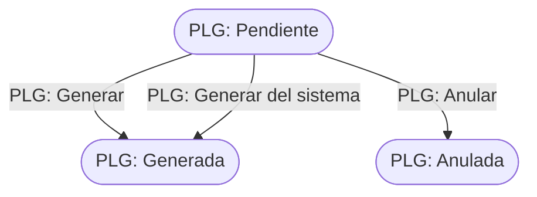

# Flujo del negocio 'Planificaciones de venta' para el tipo 'PLG: General'

Una planificación de venta es una ejecución prevista de un planificador de ventas (por ejemplo, de un contrato): en su fecha de ejecución genera un **parte de trabajo** o una **prefactura** al cliente. El estado inicial del tipo es **PLG: Pendiente**.

Las transiciones marcadas **(manual)** las aplica el usuario desde la planificación. La marcada **(sistema)** la aplica el propio sistema (el trabajo que ejecuta las planificaciones vencidas).

## Flujo

| Estado | Etapa | Observaciones |
|---|---|---|
| PLG: Pendiente | `PLF_Etapa_Pendiente` | Estado inicial. Se editan las líneas y la fecha de ejecución; se crea un evento en la agenda. |
| PLG: Generada | `PLF_Etapa_Generada` | Estado terminado: ya tiene su parte de trabajo o su prefactura. |
| PLG: Anulada | `PLF_Etapa_Anulada` | Estado final: la ejecución prevista no se llevará a cabo. |

## Transiciones

### PLG: Pendiente ---> PLG: Generar --> PLG: Generada  (manual)
Ejecuta la planificación antes de su fecha o a demanda.
- Si la planificación indica un **tipo de parte**, crea el **parte de trabajo** y lo asocia; si ya tenía uno generado, no deja.
- Si indica un **tipo de factura**, crea la **prefactura** y la asocia; si ya tenía una, no deja.
- Si no indica ni parte ni factura a generar, no deja.
- Una planificación con parte o factura generados pasa a ser de solo consulta.

### PLG: Pendiente ---> PLG: Generar (del sistema) --> PLG: Generada  (sistema)
Lo mismo que *Generar*, pero lo aplica el sistema al llegar la fecha de ejecución de la planificación.

### PLG: Pendiente ---> PLG: Anular --> PLG: Anulada  (manual)
Descarta la ejecución prevista. Pide el **motivo de anulación**.
- Tras transitar desvincula los eventos de la agenda de la planificación.
- Si pertenece a un contrato, **recalcula su avance** descontando el importe de la planificación.

## Comportamiento común a todas las transiciones
- Cada transición queda anotada en el historial (hitos) de la planificación.
- Solo pueden aplicarla los usuarios con permiso sobre la transición.
- Las planificaciones las crea el planificador de ventas a partir de sus propias líneas.
- Además, pueden existir **acciones de transición** definidas por el parametrizador (se ven al pinchar la flecha en el visor de flujo del estado), que se ejecutan antes o después de las anteriores.
