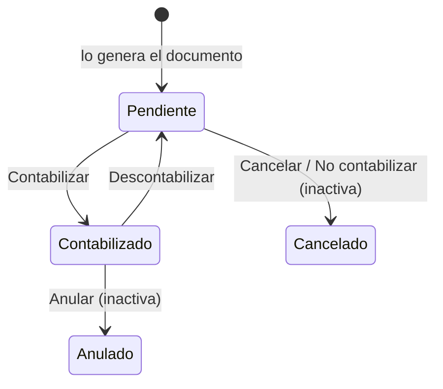

# Flujo del negocio 'Preasientos' para el tipo 'ING: Cobros'

Un preasiento es el asiento contable que genera un documento (aquí, un **cobro** de una factura emitida) antes de pasar a la contabilidad. Queda pendiente hasta que el cierre contable de la sociedad lo contabiliza. El estado inicial del tipo es **SPR: Pendiente**.

Los cinco tipos de preasiento (*GAS: Pagos*, *GAS: Recibidas*, *ING: Emitidas*, *ING: Cobros* y *ALM: Almacén*) comparten el mismo flujo de estados.

Casi todas las transiciones son **del sistema**: las aplican el cierre contable y los propios documentos, no se ejecutan a mano. Las marcadas **(inactiva)** están definidas pero dadas de baja.

## Flujo

| Estado | Etapa | Observaciones |
|---|---|---|
| SPR: Pendiente | `SPR_Etapa_Pendiente` | Estado inicial. Lo genera el documento; aún no está en la contabilidad. |
| SPR: Contabilizado | `SPR_Etapa_Contabilizado` | Estado terminado: incluido en un cierre o lote contable ya traspasado. |
| SPR: Cancelado | `SPR_Etapa_Cancelado` | Estado final: el documento se canceló o el preasiento se regeneró. |
| SPR: Anulado | `SPR_Etapa_Anulado` | Estado final: anulación en contabilidad (hoy sin transición activa que llegue a él). |

## Transiciones

### SPR: Pendiente ---> SPR: Contabilizar --> SPR: Contabilizado  (sistema)
Se aplica al **ejecutar el cierre contable** (o crear el lote contable) de la sociedad, o al **activar los preasientos** de una sociedad cuyo documento tiene fecha contable anterior al último cierre.
- Solo contabiliza los preasientos pendientes del ejercicio y del periodo del cierre.
- Si el documento al que pertenece el preasiento está cancelado, el preasiento se cancela en lugar de contabilizarse.
- Al activar los preasientos de una sociedad con fecha contable anterior al último cierre, deja la traza «Contabilizado al activar los preasientos».

### SPR: Pendiente ---> SPR: Cancelar --> SPR: Cancelado  (sistema)
Se aplica cuando el documento origen **deja de necesitar el preasiento**: se cancela el cobro, se devuelve a pendiente, o se regenera el preasiento (el anterior queda cancelado y se crea otro).
- No deja si hay un **cierre contable en curso** para la sociedad ni si el preasiento ya pertenece a un periodo **cerrado**.
- Deja asunto y detalle indicando por qué se canceló (por ejemplo, «Se ha regenerado el preasiento desde la interface»).
- Un preasiento que no está pendiente no se puede cancelar ni regenerar; si está contabilizado, el mensaje indica cómo devolverlo a pendiente.

### SPR: Pendiente ---> SPR: No contabilizar --> SPR: Cancelado  (inactiva)
Estaba pensada para que un usuario descartara a mano un preasiento, indicando el **motivo de no contabilización**. Está dada de baja: no se puede aplicar.

### SPR: Contabilizado ---> SPR: Descontabilizar --> SPR: Pendiente  (sistema)
Se aplica al **anular el lote contable** donde estaba el preasiento o al **eliminar el cierre contable** correspondiente (solo se puede eliminar el último cierre de la sociedad, así que antes hay que eliminar los posteriores). También al crear un lote indicando que se descontabilice.

### SPR: Contabilizado ---> SPR: Anular --> SPR: Anulado  (inactiva)
Estaba pensada para anular un preasiento ya contabilizado. Está dada de baja: no se puede aplicar.

## Comportamiento común a todas las transiciones
- Cada transición queda anotada en el historial (hitos) del preasiento.
- Solo pueden aplicarla los usuarios con permiso sobre la transición.
- Un preasiento cuya fecha contable es anterior al último cierre de la sociedad se crea con la fecha del último cierre (salvo las facturas emitidas, que conservan su fecha de devengo).
- Además, pueden existir **acciones de transición** definidas por el parametrizador (se ven al pinchar la flecha en el visor de flujo del estado), que se ejecutan antes o después de las anteriores.
- Más detalle del proceso en el manual *Proceso de cierre contable*.
