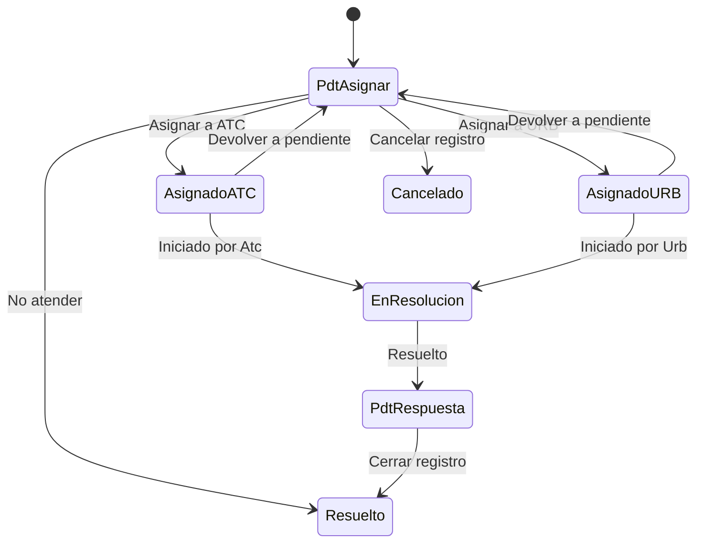

# Flujo del negocio 'Registro de entrada' para el tipo 'REE: General'

El registro de entrada recoge las peticiones que llegan a la organización (en este tipo, de la clase *Entrada*). Un administrativo lo asigna al servicio que ha de resolverlo (ATC o URB); al asignarlo se crea una **tarea de resolución** y se dan permisos de consulta al puesto de trabajo. El estado inicial del tipo es **REE: Pendiente de asignar**.

Las transiciones marcadas **(manual)** las aplica el usuario desde el registro. Las marcadas **(sistema)** las aplica el propio sistema cuando se mueven las tareas de resolución asociadas.

## Flujo

En el diagrama, *PdtAsignar* es **REE: Pendiente de asignar**, *PdtRespuesta* es **REE: Pdt de respuesta** y *Resuelto* es **REE: Resuelto**.

| Estado | Etapa | Observaciones |
|---|---|---|
| REE: Pendiente de asignar | (sin etapa definida) | Estado inicial. |
| REE: Asignado a ATC | (sin etapa definida) | Asignado al servicio de atención al ciudadano. |
| REE: Asignado a URB | (sin etapa definida) | Asignado al servicio de urbanismo. |
| REE: En resolución | (sin etapa definida) | Su tarea de resolución está iniciada. |
| REE: Pdt de respuesta | (sin etapa definida) | Resuelto internamente; falta contestar al interesado. |
| REE: Resuelto | (sin etapa definida) | Estado terminado. |
| REE: Cancelado | (sin etapa definida) | Estado final: registro cancelado. |

## Transiciones

### REE: Pendiente de asignar ---> REE: Asignar a ATC --> REE: Asignado a ATC  (manual)
Asigna el registro al servicio ATC.
- Tras transitar **crea una tarea de resolución** (tipo *TRR: Resolución de REE*) en el centro gestor de ATC.
- Otorga permisos de consultor sobre el registro al puesto de trabajo administrativo y envía un **mensaje** a los usuarios de ese puesto.

### REE: Pendiente de asignar ---> REE: Asignar a URB --> REE: Asignado a URB  (manual)
Asigna el registro al servicio URB. Funciona igual que *Asignar a ATC*, con el centro gestor y el puesto de trabajo técnico de URB.

### REE: Pendiente de asignar ---> REE: No atender --> REE: Resuelto  (manual)
Cierra el registro sin darle curso. No ejecuta ninguna comprobación ni cambio propio: solo cambia de estado.

### REE: Pendiente de asignar ---> REE: Cancelar registro --> REE: Cancelado  (manual)
Cancela el registro. Pide el **motivo de cancelación**. No ejecuta ninguna comprobación ni cambio propio: solo cambia de estado.

### REE: Asignado a ATC ---> REE: Iniciado por Atc --> REE: En resolución  (sistema)
Se aplica cuando el responsable **inicia la tarea de resolución** del registro (acción de la transición *TRR: En resolución*).

### REE: Asignado a URB ---> REE: Iniciado por Urb --> REE: En resolución  (sistema)
Igual que la anterior, para el servicio URB.

### REE: Asignado a ATC ---> REE: Devolver a pendiente --> REE: Pendiente de asignar  (manual)
Devuelve el registro para reasignarlo. Pide el motivo de devolución.
- Antes de transitar exige que las tareas del registro estén **canceladas**.
- Después quita los permisos de consultor otorgados al puesto de trabajo.

### REE: Asignado a URB ---> REE: Devolver a pendiente --> REE: Pendiente de asignar  (manual)
Igual que la anterior, quitando los permisos del puesto de trabajo técnico de URB.

### REE: En resolución ---> REE: Resuelto --> REE: Pdt de respuesta  (sistema)
Se aplica cuando **se resuelven todas las tareas** del registro (acción de la transición *TRR: Realizado*): si las demás tareas están terminadas o canceladas, el registro pasa a pendiente de respuesta. Antes de transitar valida que las tareas relacionadas no estén en circuito.

### REE: Pdt de respuesta ---> REE: Cerrar registro --> REE: Resuelto  (manual)
Da el registro por contestado y lo cierra. No ejecuta ninguna comprobación ni cambio propio: solo cambia de estado.

## Comportamiento común a todas las transiciones
- Cada transición queda anotada en el historial (hitos) del registro.
- Solo pueden aplicarla los usuarios con permiso sobre la transición.
- Los permisos y las tareas se gestionan mediante **acciones de transición** definidas al inicializar el sistema; el parametrizador puede añadir otras (se ven al pinchar la flecha en el visor de flujo del estado).
