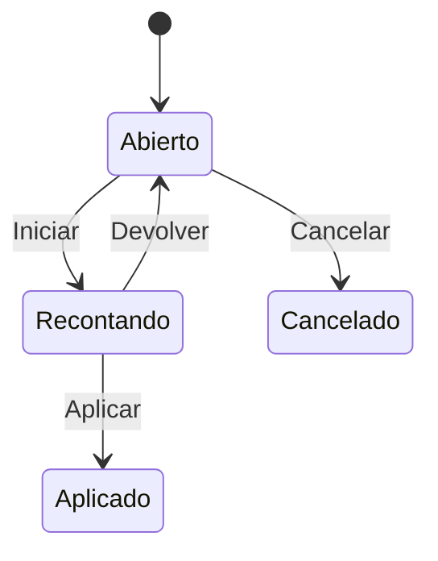

# Flujo del negocio 'Regularizaciones de almacén' para el tipo 'Ajustes de precio'

El tipo **Ajustes de precio** (sigla `APR`) sirve para corregir el precio de las existencias de un almacén. El estado inicial del tipo es **RAL: Abierto**.

Los tres tipos de regularización (*Inventario Inicial*, *Recuentos* y *Ajustes de precio*) comparten el mismo flujo de estados.

## Flujo

| Estado | Etapa | Observaciones |
|---|---|---|
| RAL: Abierto | `RAL_Inicial` | Estado inicial. Se crea la regularización y se prepara; aún no hay recuento. |
| RAL: Recontando | `RAL_Recontando` | El almacén está bloqueado en inventario y se introducen las líneas. |
| RAL: Aplicado | `RAL_Cerrado` | Estado terminado: el ajuste está aplicado. |
| RAL: Cancelado | `RAL_Cancelar` | Estado final: la regularización no se llevó a cabo. |

## Transiciones

### RAL: Abierto ---> RAL: Iniciar --> RAL: Recontando
Empieza el ajuste.
- El almacén debe estar **abierto** (*ALM: Abierto*); si no, no deja.
- Pasa el almacén a **ALM: En inventario** (transición del sistema *Inventariar*), con lo que deja de admitir movimientos normales.
- Solo puede haber una regularización en curso (abierta o recontando) por almacén; se comprueba ya al crearla.

### RAL: Abierto ---> RAL: Cancelar --> RAL: Cancelado
Descarta la regularización. Pide el **motivo de cancelación**. No ejecuta ninguna comprobación ni cambio propio: solo cambia de estado.

### RAL: Recontando ---> RAL: Aplicar --> RAL: Aplicado
Da por bueno el ajuste.
- En el código revisado, la generación de movimientos de stock al aplicar solo está implementada para el tipo *Inventario Inicial*; en los ajustes de precio esta transición cambia el estado y devuelve el almacén a abierto.
- Tras transitar devuelve el almacén a **ALM: Abierto** (transición del sistema *Inventario aplicado*).

### RAL: Recontando ---> RAL: Devolver --> RAL: Abierto
Cancela el ajuste y vuelve a la preparación.
- No deja si la regularización ya tiene **líneas**: hay que borrarlas antes.
- Tras transitar devuelve el almacén a **ALM: Abierto**.

## Comportamiento común a todas las transiciones
- Cada transición queda anotada en el historial (hitos) de la regularización.
- Solo pueden aplicarla los usuarios con permiso sobre la transición.
- Mientras la regularización está en curso el almacén no se puede cerrar ni cancelar.
- Además, pueden existir **acciones de transición** definidas por el parametrizador (se ven al pinchar la flecha en el visor de flujo del estado), que se ejecutan antes o después de las anteriores.
