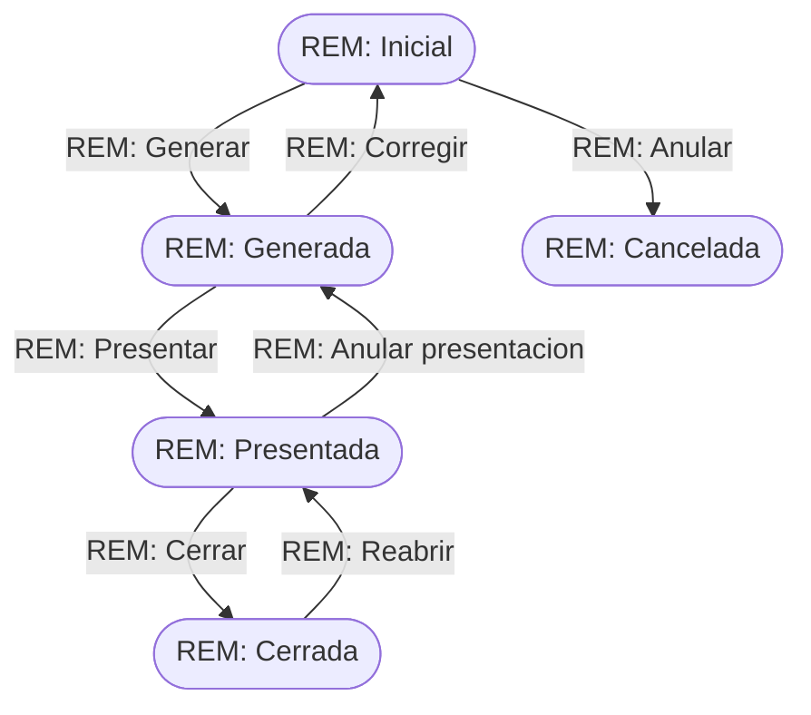

# Flujo del negocio 'Remesas de cobro' para el tipo 'REM: General'

Las remesas de cobro agrupan facturas emitidas para cobrarlas por domiciliación SEPA. El estado inicial del tipo es **REM: Inicial**.

## Flujo

| Estado | Etapa | Observaciones |
|---|---|---|
| REM: Inicial | Cumplimentación | Estado inicial. Se añaden las facturas a la remesa. |
| REM: Generada | Generada | Fichero SEPA generado y aún no enviado al banco. |
| REM: Presentada | Presentación | Fichero enviado al banco. |
| REM: Cerrada | Cierre | Estado final: cerrada la ventana de devoluciones. |
| REM: Cancelada | Cancelada | Estado final: remesa anulada. |

## Transiciones

### REM: Inicial ---> REM: Generar --> REM: Generada
Pasa la remesa a generada y crea el fichero de adeudos.
- Comprueba que la remesa tiene al menos una factura asociada; si no, no deja generarla.
- Anota la fecha y hora de generación y calcula la **fecha de cargo**: la fecha de generación más los días del parámetro `REM_DiasDeEsperaDeCargo`.
- Tras transitar genera el fichero **SEPA pain.008** (`Rem-<referencia>.xml`), lo sube al gestor documental y lo anexa a la remesa.

### REM: Inicial ---> REM: Anular --> REM: Cancelada
Cancela una remesa que aún no se ha generado. Pide el **motivo de anulación**.
- Si la remesa tiene facturas asociadas no deja cancelarla: hay que quitarlas antes.

### REM: Generada ---> REM: Corregir --> REM: Inicial
Devuelve la remesa a cumplimentación para poder corregirla. Pide el **motivo de apertura**.
- Desvincula el fichero SEPA de la remesa y borra las fechas de generación y de cargo.
- Tras transitar quita el fichero anexado y deja una traza: "Remesa retrocedida para corrección", con el usuario que lo hizo.

### REM: Generada ---> REM: Presentar --> REM: Presentada
Marca que la remesa se ha enviado al banco.
- Exige que la remesa tenga fecha de cargo.
- Anota la fecha y hora de presentación y valida que la fecha de cargo sea, al menos, `REM_DiasDeEsperaDeCargo` días posterior a la presentación.

### REM: Presentada ---> REM: Anular presentacion --> REM: Generada
Deshace la presentación. Pide el **motivo de anulación de presentación**.
- Borra la fecha de presentación.
- Tras transitar deja una traza: "Presentación anulada", con el usuario que lo hizo.

### REM: Presentada ---> REM: Cerrar --> REM: Cerrada
Da la remesa por conciliada y la cierra.
- No deja cerrarla hasta que haya pasado la **fecha máxima de devolución**: la fecha en que se cargó la remesa (o, si aún no consta, la fecha de cargo prevista) más los meses del parámetro `REM_MesesDeEsperaDeDevolucionDeCargos`. Hasta entonces el cliente aún puede devolver cargos.

### REM: Cerrada ---> REM: Reabrir --> REM: Presentada
Reabre una remesa cerrada. Pide el **motivo de reapertura**.
- No ejecuta ninguna comprobación ni cambio propio del negocio: solo cambia de estado.

## Comportamiento común a todas las transiciones
- Cada transición queda anotada en el historial (hitos) del elemento.
- Solo pueden aplicarla los usuarios con permiso sobre la transición.
- Además, pueden existir **acciones de transición** definidas por el parametrizador (se ven al pinchar la flecha en el visor de flujo del estado), que se ejecutan antes o después de las anteriores.
