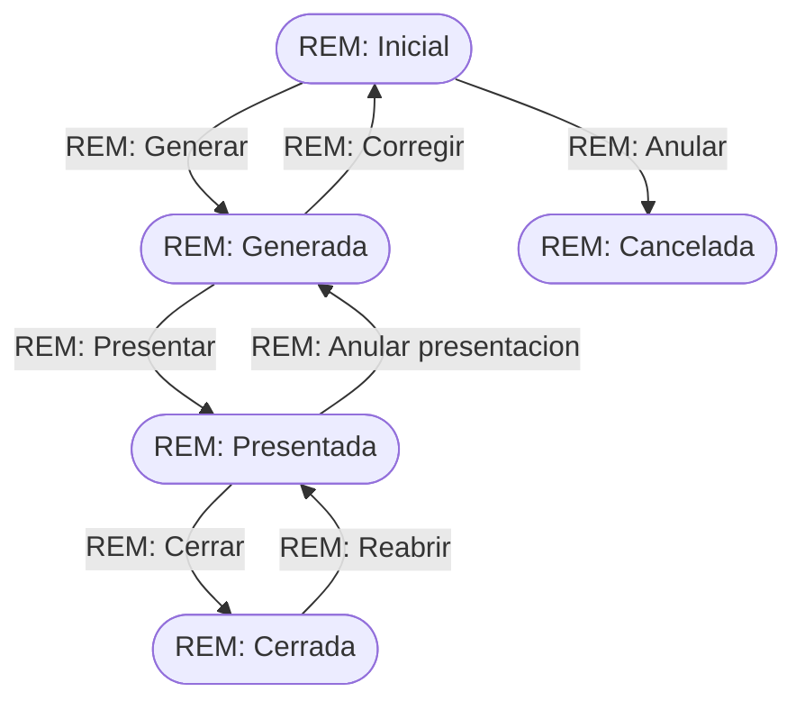

# Flujo del negocio 'Remesas de pago' para el tipo 'REM: General'

Las remesas de pago agrupan pagos a proveedores para pagarlos en bloque mediante transferencia SEPA. El estado inicial del tipo es **REM: Inicial**.

## Flujo

| Estado | Etapa | Observaciones |
|---|---|---|
| REM: Inicial | `REM_Etapa_De_Cumplimentacion` | Estado inicial. Se añaden los pagos a la remesa; es el único estado en que se puede modificar. |
| REM: Generada | `REM_Etapa_Generada` | Fichero SEPA generado y aún no enviado al banco. |
| REM: Presentada | `REM_Etapa_De_Presentacion` | Fichero enviado al banco; a la espera de la fecha de pago. |
| REM: Cerrada | `REM_Etapa_De_Cierre` | Estado final: pagos realizados. |
| REM: Cancelada | `REM_Etapa_Cancelada` | Estado final: remesa anulada. |

## Transiciones

### REM: Inicial ---> REM: Generar --> REM: Generada
Pasa la remesa a generada y crea el fichero de transferencias.
- Comprueba que la remesa tiene al menos un pago; si no, no deja generarla.
- Anota la fecha y hora de generación. Si la remesa no tiene fecha de pago, la calcula como la de generación más los días del parámetro `REM_DiasDeTransferencia` (por defecto 1).
- Tras transitar genera el fichero **SEPA pain.001** y lo anexa a la remesa.

### REM: Inicial ---> REM: Anular --> REM: Cancelada
Cancela una remesa que aún no se ha generado. Pide el **motivo de anulación**.
- Si la remesa tiene pagos asociados no deja cancelarla: hay que quitarlos antes.

### REM: Generada ---> REM: Corregir --> REM: Inicial
Devuelve la remesa a cumplimentación para poder corregirla. Pide el **motivo de apertura**.
- Desvincula el fichero SEPA de la remesa y borra las fechas de generación y de pago.
- Tras transitar quita el fichero anexado y deja una traza: "Remesa retrocedida para corrección", con el usuario que lo hizo.

### REM: Generada ---> REM: Presentar --> REM: Presentada
Marca que la remesa se ha enviado al banco.
- Exige que la remesa tenga fecha de pago.
- Anota la fecha y hora de presentación y valida que la fecha de pago sea, al menos, `REM_DiasDeTransferencia` días posterior a la presentación.

### REM: Presentada ---> REM: Anular presentacion --> REM: Generada
Deshace la presentación. Pide el **motivo de anulación de presentación**.
- No deja si la remesa ya tiene pagos realizados o anulados.
- Borra las fechas de presentación y de pago realizado.
- Tras transitar deja una traza: "Presentación anulada", con el usuario que lo hizo.

### REM: Presentada ---> REM: Cerrar --> REM: Cerrada
Da la remesa por pagada y la cierra.
- No deja cerrarla mientras no se haya cumplido la **fecha de pago** (salvo que ya conste fecha de pago realizado); ni si la fecha de pago realizado es futura.
- Si no consta fecha de pago realizado, anota la de hoy. Al informarse esa fecha, los pagos que seguían en la remesa pasan de **PAG: Remesado** a **PAG: Pagado** (transición *Cerrar remesa*).
- Tras transitar quita el evento de pago de la agenda de la sociedad.

### REM: Cerrada ---> REM: Reabrir --> REM: Presentada
Reabre una remesa cerrada. Pide el **motivo de reapertura**.
- No ejecuta ninguna comprobación ni cambio propio del negocio: solo cambia de estado.

## Comportamiento común a todas las transiciones
- Cada transición queda anotada en el historial (hitos) de la remesa.
- Solo pueden aplicarla los usuarios con permiso sobre la transición.
- La fecha de pago de la remesa crea un **evento en la agenda** de la sociedad; si se modifica, se actualiza el evento y la fecha de los pagos de la remesa, dejando traza.
- Dar por pagada una remesa (o anular su pago) por una vía distinta del cierre exige un perfil de intervención.
- Además, pueden existir **acciones de transición** definidas por el parametrizador (se ven al pinchar la flecha en el visor de flujo del estado), que se ejecutan antes o después de las anteriores.
