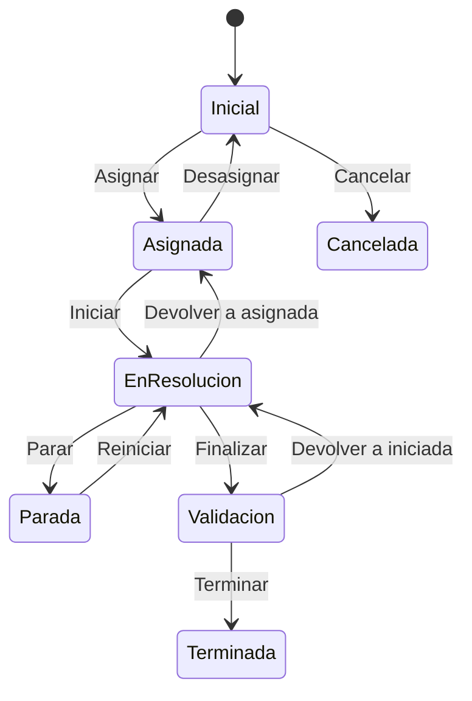

# Flujo del negocio 'Tareas' para el tipo 'PLF: Tarea planificada'

Una tarea planificada es una tarea de control con fechas de planificación y archivador interno propio; se asigna a un responsable, se resuelve y se valida. El estado inicial del tipo es **PLF: Pendiente**.

Todas las transiciones de este flujo las aplica el usuario desde la tarea.

## Flujo

En el diagrama, *Inicial* es **PLF: Pendiente**, *EnResolucion* es **PLF: Iniciada** y *Validacion* es **PLF: Resuelta**.

| Estado | Etapa | Observaciones |
|---|---|---|
| PLF: Pendiente | `TAR_Etapa_Inicial` | Estado inicial. Sin responsable asignado. |
| PLF: Asignada | `TAR_Etapa_Asignada` | Tiene responsable y planificación. |
| PLF: Iniciada | `TAR_Etapa_En_Resolucion` | El responsable está trabajando en ella. |
| PLF: Parada | `TAR_Etapa_En_Espera` | Detenida temporalmente. |
| PLF: Resuelta | `TAR_Etapa_Validacion` | Finalizada por el responsable; pendiente de que se acepte. |
| PLF: Terminada | `TAR_Etapa_Terminada` | Estado terminado: aceptada. |
| PLF: Cancelada | `TAR_Etapa_Cancelado` | Estado final: la tarea no se realizó. |

## Transiciones

### PLF: Pendiente ---> PLF: Asignar --> PLF: Asignada
Asigna la tarea a su responsable.
- Si la tarea tiene planificación, exige que tenga **responsable** y fechas de planificación inicial y final.
- Tras transitar envía un **correo al responsable** (si no es quien asigna) con un enlace a la tarea y crea el **evento de planificación** en su agenda.

### PLF: Pendiente ---> PLF: Cancelar --> PLF: Cancelada
Anula una tarea que aún no se ha asignado. Pide el **motivo de cancelación**. No ejecuta ninguna comprobación ni cambio propio: solo cambia de estado.

### PLF: Asignada ---> PLF: Desasignar --> PLF: Pendiente
Quita la asignación. Pide el **motivo de desasignar**.
- No deja si la planificación ya tiene datos de inicio, fin, duración o unidad de medida: hay que blanquearlos antes.
- Tras transitar envía un correo al responsable avisando de que ya no tiene que realizarla, **quita el evento** de su agenda y deja la tarea sin responsable.

### PLF: Asignada ---> PLF: Iniciar --> PLF: Iniciada
El responsable empieza a trabajar. Si la planificación no tiene fecha de inicio, anota la de ahora.

### PLF: Iniciada ---> PLF: Devolver a asignada --> PLF: Asignada
Deshace el inicio de la tarea. Pide el **motivo de devolución a asignada**. Borra la fecha de inicio de la planificación.

### PLF: Iniciada ---> PLF: Parar --> PLF: Parada
Detiene temporalmente la tarea. Pide el **motivo de parar la tarea**. No ejecuta ninguna comprobación ni cambio propio: solo cambia de estado.

### PLF: Parada ---> PLF: Reiniciar --> PLF: Iniciada
Reanuda una tarea parada. No ejecuta ninguna comprobación ni cambio propio: solo cambia de estado.

### PLF: Iniciada ---> PLF: Finalizar --> PLF: Resuelta
El responsable da la tarea por realizada y la deja pendiente de validar.
- La fecha de fin no puede ser posterior a hoy ni anterior al inicio; si faltan la fecha de fin, la duración o su unidad de medida, se validan los datos de durabilidad.
- Tras transitar anota la fecha de fin (la de ahora, si no consta) y, si no se indicó la **duración**, la calcula, siempre que el parámetro `TAR_Proponer_Valoracion_Al_Finalizar` esté activo; si no, exige indicarla.

### PLF: Resuelta ---> PLF: Devolver a iniciada --> PLF: Iniciada
Quien valida no acepta la finalización. Pide el **motivo de devolución a iniciada**.
- Borra la fecha de fin y, si `TAR_Eliminar_Valoracio_Tras_Rechazar` está activo, también la duración y su unidad, dejando una traza con los datos suprimidos.

### PLF: Resuelta ---> PLF: Terminar --> PLF: Terminada
Quien valida acepta la tarea.
- Si el tipo de tarea define **clases** y la tarea no tiene ninguna indicada, no deja terminarla.

## Comportamiento común a todas las transiciones
- Cada transición queda anotada en el historial (hitos) de la tarea.
- Solo pueden aplicarla los usuarios con permiso sobre la transición.
- Una tarea incluida en una factura emitida solo puede transitar mientras la factura es una prefactura.
- Además, pueden existir **acciones de transición** definidas por el parametrizador (se ven al pinchar la flecha en el visor de flujo del estado), que se ejecutan antes o después de las anteriores.
