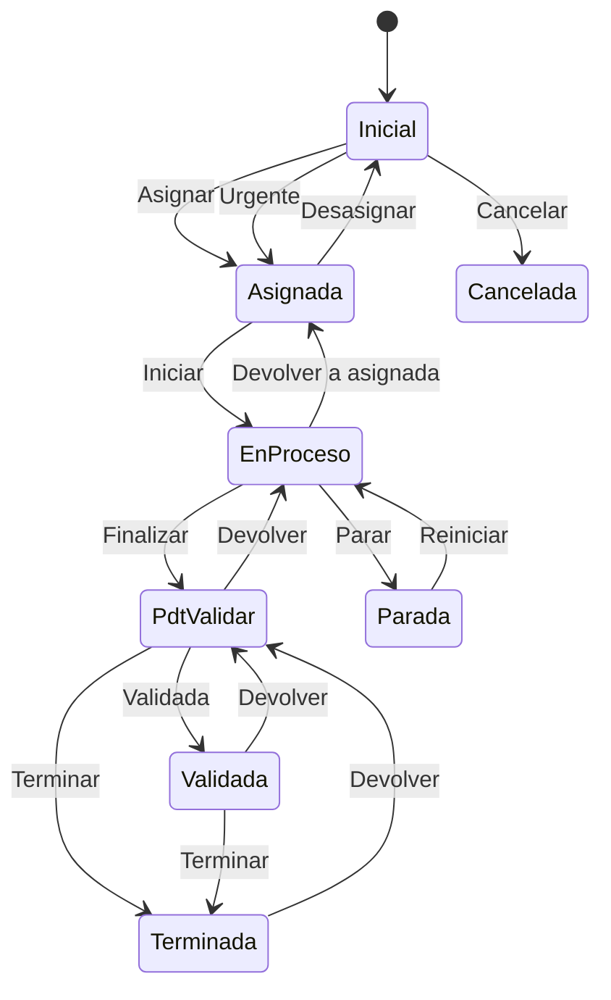

# Flujo del negocio 'Tareas' para el tipo 'SSII: Soporte'

Una tarea de soporte recoge una petición de soporte o corrección de los sistemas de información. Es un tipo de tarea de **control**, hijo de *SSII: Estatum*, con **planificación** y **facturable** (sus tareas se pueden incluir en una prefactura). Su sigla es `SPC` y su estado inicial es **SPC: Inicial**.

> Este documento se ha obtenido de la definición que tiene el tipo en la base de datos `SE_SECIFY`, que difiere de la que crea el código de inicialización (allí el tipo se llama *SSII: Correctivo* y sus estados *En Resolución* y *En validación*). Aquí se describe lo que está realmente configurado en esa base de datos.

Todas las transiciones de este flujo las aplica el usuario desde la tarea.

## Flujo

En el diagrama, *EnProceso* es **SPC: En proceso** y *PdtValidar* es **SPC: Pdt. validar**.

| Estado | Etapa | Observaciones |
|---|---|---|
| SPC: Inicial | `TAR_Etapa_Inicial` | Estado inicial. Sin responsable asignado. |
| SPC: Asignada | `TAR_Etapa_Asignada` | Tiene responsable y planificación. |
| SPC: En proceso | `TAR_Etapa_En_Resolucion` | El responsable está trabajando en ella. |
| SPC: Parada | `TAR_Etapa_En_Espera` | Detenida temporalmente. |
| SPC: Pdt. validar | `TAR_Etapa_Validacion` | Finalizada por el responsable; pendiente de revisión. |
| SPC: Validada | `TAR_Etapa_Validacion` | Revisada y aceptada; a falta de darla por terminada. |
| SPC: Terminada | `TAR_Etapa_Terminada` | Estado terminado. |
| SPC: Cancelada | `TAR_Etapa_Cancelado` | Estado final: la tarea no se realizó. |

## Transiciones

### SPC: Inicial ---> SPC: Asignar --> SPC: Asignada
Asigna la tarea a su responsable.
- Si la tarea tiene planificación, exige que tenga **responsable** y fechas de planificación inicial y final.
- Tras transitar envía un **correo al responsable** (si no es quien asigna) con un enlace a la tarea y crea el **evento de planificación** en su agenda.

### SPC: Inicial ---> SPC: Urgente --> SPC: Asignada
Igual que *Asignar*, para una petición urgente. Pide el **motivo de urgencia**.
- Mismas comprobaciones y efectos que *Asignar*.
- Además, tras transitar **envía un correo al responsable de Secify** avisando de la urgencia (acción de transición definida en la base de datos).

### SPC: Inicial ---> SPC: Cancelar --> SPC: Cancelada
Anula una tarea que aún no se ha asignado. Pide el **motivo de cancelación**. No ejecuta ninguna comprobación ni cambio propio: solo cambia de estado.

### SPC: Asignada ---> SPC: Iniciar --> SPC: En proceso
El responsable empieza a trabajar. Si la planificación no tiene fecha de inicio, anota la de ahora.

### SPC: Asignada ---> SPC: Desasignar --> SPC: Inicial
Quita la asignación. Pide el **motivo de desasignar**.
- No deja si la planificación ya tiene datos de inicio, fin, duración o unidad de medida: hay que blanquearlos antes.
- Tras transitar envía un correo al responsable avisando de que ya no tiene que realizarla, **quita el evento** de su agenda y deja la tarea sin responsable.

### SPC: En proceso ---> SPC: Finalizar --> SPC: Pdt. validar
El responsable da la tarea por realizada.
- La fecha de fin no puede ser posterior a hoy ni anterior al inicio; si faltan la fecha de fin, la duración o su unidad de medida, se validan los datos de durabilidad.
- Tras transitar anota la fecha de fin (la de ahora, si no consta) y, si no se indicó la **duración**, la calcula, siempre que el parámetro `TAR_Proponer_Valoracion_Al_Finalizar` esté activo; si no, exige indicarla.

### SPC: En proceso ---> SPC: Devolver a asignada --> SPC: Asignada
Deshace el inicio de la tarea. Pide el **motivo de devolución a asignada**. Borra la fecha de inicio de la planificación.

### SPC: En proceso ---> SPC: Parar --> SPC: Parada
Detiene temporalmente la tarea. Pide el **motivo de parar la tarea**. No ejecuta ninguna comprobación ni cambio propio: solo cambia de estado.

### SPC: Parada ---> SPC: Reiniciar --> SPC: En proceso
Reanuda una tarea parada. No ejecuta ninguna comprobación ni cambio propio: solo cambia de estado.

### SPC: Pdt. validar ---> SPC: Devolver --> SPC: En proceso
Quien valida no acepta la finalización. Pide el **motivo de devolución**.
- Borra la fecha de fin y, si `TAR_Eliminar_Valoracio_Tras_Rechazar` está activo, también la duración y su unidad, dejando una traza con los datos suprimidos.

### SPC: Pdt. validar ---> SPC: Validada --> SPC: Validada
Quien valida acepta el trabajo y lo marca como validado (es la transición por defecto del estado). No ejecuta ninguna comprobación ni cambio propio: solo cambia de estado, dentro de la misma etapa de validación.

### SPC: Pdt. validar ---> SPC: Terminar --> SPC: Terminada
Da la tarea por terminada directamente, sin pasar por *Validada*.
- Si el tipo de tarea define **clases** y la tarea no tiene ninguna indicada, no deja terminarla.

### SPC: Validada ---> SPC: Terminar --> SPC: Terminada
Da por terminada una tarea ya validada (es la transición por defecto del estado). Igual que la anterior, exige la **clase** si el tipo las define.

### SPC: Validada ---> SPC: Devolver --> SPC: Pdt. validar
Retira la validación. Pide el **motivo de devolución**. Solo cambia de estado.

### SPC: Terminada ---> SPC: Devolver --> SPC: Pdt. validar
Reabre una tarea terminada para revisarla de nuevo. Pide el **motivo de validación**. Solo cambia de estado.

## Comportamiento común a todas las transiciones
- Cada transición queda anotada en el historial (hitos) de la tarea.
- Solo pueden aplicarla los usuarios con permiso sobre la transición.
- Una tarea incluida en una factura emitida solo puede transitar mientras la factura es una prefactura.
- Además, pueden existir otras **acciones de transición** definidas por el parametrizador (se ven al pinchar la flecha en el visor de flujo del estado).
