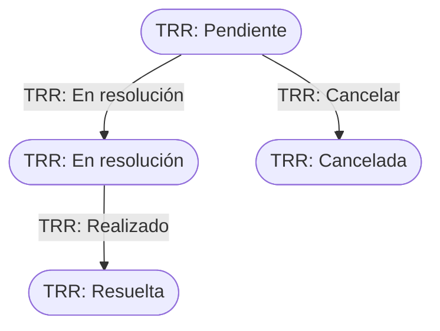

# Flujo del negocio 'Tareas' para el tipo 'TRR: Resolución de REE'

Una tarea de este tipo se crea al asignar un registro de entrada a un servicio (ATC o URB) y representa el trabajo de resolverlo. Es una tarea de clase *Registro* sin planificación. El estado inicial del tipo es **TRR: Pendiente**.

Sus transiciones tienen **acciones de transición** que mueven el registro de entrada asociado.

## Flujo

| Estado | Etapa | Observaciones |
|---|---|---|
| TRR: Pendiente | `TAR_Etapa_Inicial` | Estado inicial. |
| TRR: En resolución | `TAR_Etapa_En_Resolucion` | El responsable está resolviendo el registro. |
| TRR: Resuelta | `TAR_Etapa_Terminada` | Estado terminado. |
| TRR: Cancelada | `TAR_Etapa_Cancelado` | Estado final: tarea cancelada. |

## Transiciones

### TRR: Pendiente ---> TRR: En resolución --> TRR: En resolución
Empieza a resolver el registro.
- Acción posterior: **transita el registro de entrada** a *REE: En resolución* (*Iniciado por Atc* o *Iniciado por Urb*), si no lo está ya.

### TRR: En resolución ---> TRR: Realizado --> TRR: Resuelta
Da por resuelta la tarea.
- Acción posterior: si todas las demás tareas del registro están terminadas o canceladas, **transita el registro** a *REE: Pdt de respuesta*.

### TRR: Pendiente ---> TRR: Cancelar --> TRR: Cancelada
Cancela la tarea. Pide el **motivo de cancelación**.
- Acción posterior: si todas las demás tareas del registro están canceladas, **cancela el registro** de entrada.

## Comportamiento común a todas las transiciones
- Cada transición queda anotada en el historial (hitos) de la tarea.
- Solo pueden aplicarla los usuarios con permiso sobre la transición.
- Una tarea incluida en una factura emitida solo puede transitar mientras la factura es una prefactura.
- Además, pueden existir otras **acciones de transición** definidas por el parametrizador (se ven al pinchar la flecha en el visor de flujo del estado).
