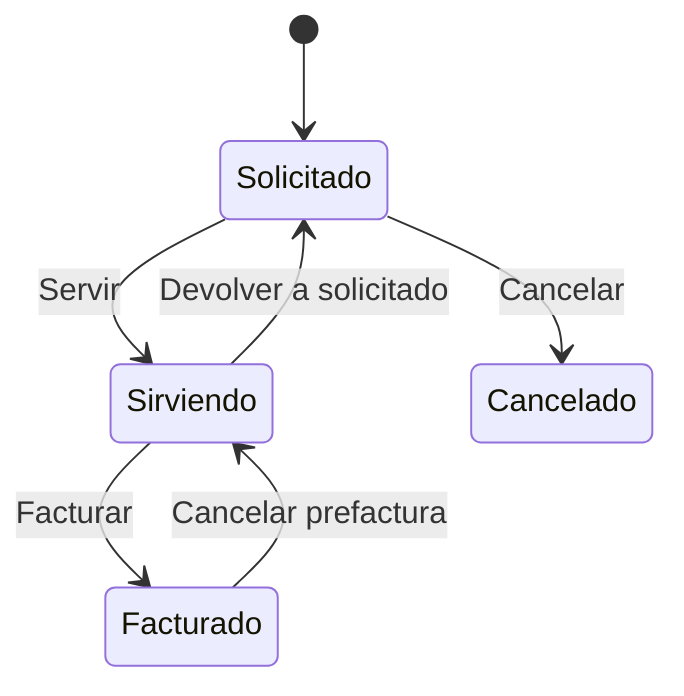

# Flujo del negocio 'Documentos de venta' para el tipo 'DSA: General'

Un documento de venta recoge la petición de un cliente de materiales y servicios: se solicita, se sirve (salidas de almacén para los materiales y partes de trabajo para la mano de obra y los servicios) y se factura. El estado inicial del tipo es **DSA: Solicitado**.

> **Estado de la implementación.** Los estados y las transiciones están definidos, pero las acciones asociadas (servir, devolver a solicitado, validar y crear la prefactura, cancelar la prefactura) están en el código como métodos preparados con `TODO`: hoy **solo cambian el estado**. Lo que se describe en cada transición es lo previsto en el análisis; se indica qué está hecho y qué no.

Las transiciones marcadas **(manual)** las aplica el usuario desde el documento. Las marcadas **(sistema)** las aplicará el propio sistema como consecuencia de otra operación (una salida de almacén, la cancelación de una prefactura).

## Flujo

| Estado | Etapa | Observaciones |
|---|---|---|
| DSA: Solicitado | `DSA_Etapa_Solicitud` | Estado inicial. Se editan las líneas, se procesa la solicitud o se cancela. |
| DSA: Sirviendo | `DSA_Etapa_Servicio` | Se sirve material, se realizan partes y se puede facturar. |
| DSA: Facturado | `DSA_Etapa_Facturacion` | Estado terminado: ya tiene prefactura. Solo consulta, salvo que se cancele la prefactura. |
| DSA: Cancelado | `DSA_Etapa_Cancelacion` | Estado final: el cliente desiste antes de servir. |

## Transiciones

### DSA: Solicitado ---> DSA: Servir --> DSA: Sirviendo  (sistema)
Se debe aplicar al realizar la **primera salida de almacén** del documento. Está previsto que fije la fecha de servicio (`ServidoEl`).
- Pendiente de implementar: hoy el método `Servir` está vacío (`TODO`).

### DSA: Solicitado ---> DSA: Cancelar --> DSA: Cancelado  (manual)
El cliente desiste antes de servir. Pide el **motivo de cancelación**.
- Están previstas validaciones previas a la cancelación, pero aún no están implementadas (`TODO`): hoy solo cambia el estado.

### DSA: Sirviendo ---> DSA: Facturar --> DSA: Facturado  (manual)
Factura lo servido.
- Previsto: validar antes de facturar y, tras transitar, **crear la prefactura** (factura emitida) con las líneas de material servido y los partes realizados, y asignar su identificador al documento.
- Pendiente de implementar: `AntesDeFacturar` y `CrearPrefactura` están vacíos (`TODO`). Hoy solo cambia el estado.

### DSA: Sirviendo ---> DSA: Devolver a solicitado --> DSA: Solicitado  (sistema)
Se debe aplicar al **anular la última salida de almacén** del documento: vuelve a solicitado y se puede editar de nuevo. Está previsto que limpie la fecha de servicio.
- Pendiente de implementar: `DevolverASolicitado` está vacío (`TODO`).

### DSA: Facturado ---> DSA: Cancelar prefactura --> DSA: Sirviendo  (sistema)
Se debe aplicar desde el extensor de facturas emitidas al **cancelar la prefactura** del documento: desvincula la factura y vuelve a sirviendo.
- Pendiente de implementar: `CancelarPrefactura` está vacío (`TODO`) y el extensor de facturas emitidas aún no lo llama.

## Comportamiento común a todas las transiciones
- Cada transición queda anotada en el historial (hitos) del documento.
- Solo pueden aplicarla los usuarios con permiso sobre la transición.
- Además, pueden existir **acciones de transición** definidas por el parametrizador (se ven al pinchar la flecha en el visor de flujo del estado), que se ejecutan antes o después de las anteriores.
- Más detalle del proceso previsto en el manual *Proceso de venta de materiales y servicios*.
