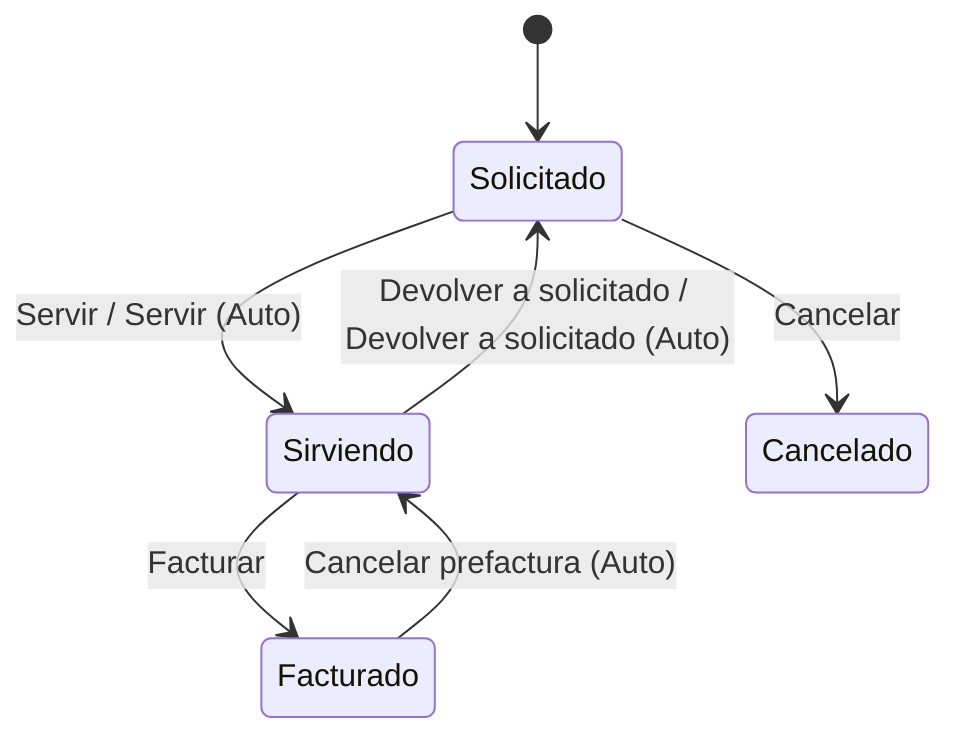

# Flujo del negocio 'Documentos de venta' para el tipo 'DSA: General'

Un documento de venta (documento de salida) recoge lo que un cliente pide de los materiales de un almacén: se prepara con sus líneas, se le envía la oferta, se sirve cuando la aprueba (es entonces cuando el material sale del almacén) y se factura. El estado inicial del tipo es **DSA: Solicitado**.

Se puede crear desde el documento de venta o desde la consulta de inventario (opción **Venta de material**), que crea el documento con una línea del material de la fila seleccionada y, si se marca, lo sirve y lo factura en el mismo paso.

Las transiciones marcadas **(manual)** las aplica el usuario desde el documento. Las marcadas **(sistema)**, con el sufijo **(Auto)**, las aplica el propio sistema como consecuencia de otra operación (la venta de material desde el inventario, la anulación de la prefactura).

## Flujo

| Estado | Etapa | Observaciones |
|---|---|---|
| DSA: Solicitado | `DSA_Etapa_Solicitud` | Estado inicial. Se editan las líneas y se imprime la oferta para el cliente (**Imprimir seleccionado**: oferta con la base imponible, sin iva). Todavía no ha salido nada del almacén. |
| DSA: Sirviendo | `DSA_Etapa_Servicio` | El material ha salido del almacén (una salida por línea) a la fecha de servicio. Se puede facturar o devolver a solicitado. |
| DSA: Facturado | `DSA_Etapa_Facturacion` | Estado terminado: tiene su prefactura. Solo consulta, salvo que se anule la prefactura. |
| DSA: Cancelado | `DSA_Etapa_Cancelacion` | Estado final: el cliente desiste antes de servir. |

## Transiciones

### DSA: Solicitado ---> DSA: Servir --> DSA: Sirviendo  (manual)
El cliente ha aprobado la oferta y se le sirve: **sale el material del almacén y se preasienta**.
- Antes de transitar: el documento ha de tener líneas; se fija la fecha de servicio (`ServidoEl`) si no estaba indicada (hoy, sin hora).
- Después de transitar, por cada línea se crea una **salida del almacén** del documento a la fecha de servicio, valorada al precio medio vigente. Al crearla:
  - se valida que haya stock suficiente a esa fecha;
  - se **preasienta** si el almacén no usa la variación de existencias: variación de existencias (61x) al debe y existencias (3xx) al haber, por la cantidad al precio medio; si la usa no se preasienta (se cuadra en el cierre contable);
  - se **barren** los movimientos posteriores del material en el almacén (stock y precio medio).
- Queda anotado en la traza del documento (salidas del almacén creadas).

### DSA: Solicitado ---> DSA: Servir (Auto) --> DSA: Sirviendo  (sistema)
La misma transición que la anterior, aplicada por el sistema al crear la venta de material desde el inventario con **Servido** marcado, a la fecha indicada en la venta. Hace lo mismo: salida del almacén, preasiento y barrido.

### DSA: Solicitado ---> DSA: Cancelar --> DSA: Cancelado  (manual)
El cliente desiste antes de servir. Pide el **motivo de cancelación**. No hay salidas del almacén que deshacer, solo cambia el estado.

### DSA: Sirviendo ---> DSA: Facturar --> DSA: Facturado  (manual)
Factura lo servido creando su **prefactura**.
- Antes de transitar se valida que el documento no tenga ya factura, que tenga líneas y que su tipo de venta indique el **tipo de prefactura** (en el mantenimiento de tipos de documentos de venta).
- Después de transitar se crea la prefactura (factura emitida sin emitir) al cliente del tipo de prefactura indicado, con una línea alzada por cada línea del documento (concepto "(referencia) nombre" del material, cantidad, precio, descuento e iva por defecto), y el documento queda apuntando a ella. Queda anotado en la traza.
- También la aplica la venta de material desde el inventario si se marca **Facturar** (que exige servido).
- La prefactura no se comunica a Hacienda hasta que se emite desde la factura.

### DSA: Sirviendo ---> DSA: Devolver a solicitado --> DSA: Solicitado  (manual)
Deshace el servicio: **se quitan del almacén las salidas** del documento y vuelve a solicitado para poder editarlo de nuevo.
- Antes de transitar se valida que ninguna salida tenga su preasiento **contabilizado** (si lo tiene no se puede devolver).
- Se eliminan las salidas del almacén del documento: su preasiento se cancela y se barren los movimientos posteriores, de modo que el stock vuelve a ser el de antes de servir.
- Se limpia la fecha de servicio (`ServidoEl`) y queda anotado en la traza (salidas del almacén anuladas).

### DSA: Sirviendo ---> DSA: Devolver a solicitado (Auto) --> DSA: Solicitado  (sistema)
La misma transición que la anterior, para cuando sea el sistema quien deshaga el servicio. Hace lo mismo: quita las salidas del almacén, cancela sus preasientos y barre.

### DSA: Facturado ---> DSA: Cancelar prefactura (Auto) --> DSA: Sirviendo  (sistema)
La aplica el sistema al **anular la prefactura** del documento (transición **FAE: Anular** de la factura emitida).
- El documento se desvincula de la prefactura y vuelve a sirviendo; sus salidas del almacén se mantienen (sigue servido).
- Queda anotado en la traza y la transición lleva una observación con el asunto "Al cancelar prefactura (referencia)" y, como cuerpo, el enlace a la prefactura anulada.

## Comportamiento común a todas las transiciones
- Cada transición queda anotada en el historial (hitos) del documento.
- Solo pueden aplicarla los usuarios con permiso sobre la transición.
- Además, pueden existir **acciones de transición** definidas por el parametrizador (se ven al pinchar la flecha en el visor de flujo del estado), que se ejecutan antes o después de las anteriores.
- Más detalle del proceso previsto en el manual *Proceso de venta de materiales y servicios*.
