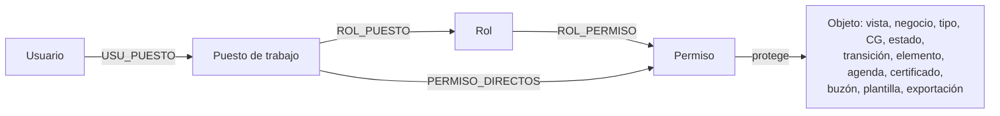

# Modelo de seguridad

Este documento explica cómo decide el sistema qué puede ver y hacer un usuario. Sirve para entender la seguridad y, sobre todo, para **diseñar los puestos de trabajo** que necesita una instalación: qué roles darles y qué permisos poner en cada rol.

La seguridad tiene dos capas que se comprueban una detrás de otra:

1. **Seguridad funcional**: ¿puede el usuario abrir esta pantalla (vista / crud)?
2. **Seguridad de datos**: dentro de la pantalla, ¿qué registros ve y en qué modo (consulta, gestión, administración)?

Ambas se resuelven con el mismo mecanismo: **permisos** que llegan al usuario a través de sus **puestos de trabajo**.

## Piezas del modelo

| Pieza | Tabla | Qué es |
|---|---|---|
| **Permiso** | `SEGURIDAD.PERMISO` | Llave que protege **un** objeto en **un** modo de acceso. Tiene una *clase* (qué protege) y un *tipo* (en qué modo). Los crea el sistema automáticamente al crear el objeto: no se dan de alta a mano. |
| **Clase de permiso** | `SEGURIDAD.CLASE_PERMISO` | Qué tipo de objeto protege: `Vista`, `Negocio`, `Tipo`, `CentroGestor`, `Estado`, `Transicion`, `Elemento`, `Agenda`, `Certificado`, `Buzon`, `Plantilla`, `Exportacion` (existen también `Menu` y `Funcion`, sin uso hoy). |
| **Tipo de permiso** | `SEGURIDAD.TIPO_PERMISO` | El modo de acceso que da: `Administrador`, `Interventor`, `Gestor`, `Consultor` (seguridad de datos) o `Acceso` (seguridad funcional). |
| **Rol** | `SEGURIDAD.ROL` | Agrupa permisos que van juntos (p.ej. "Gestor de pedidos"). Un permiso puede estar en varios roles. |
| **Puesto de trabajo** | `SEGURIDAD.PUESTO` | Lo que se asigna a los usuarios. Pertenece a un **centro gestor** (se muestra como `CG: Nombre`). Recibe permisos de dos formas: por sus **roles** y por **permisos directos** (`PERMISO_DIRECTOS`), para casos sueltos como un buzón concreto. |
| **Usuario** | `ENTORNO.USUARIO` | Recibe la unión de los permisos de todos sus puestos. Si está marcado como **administrador** se salta toda la seguridad; si además es **parametrizador**, puede modificar objetos de parametrización. |

Los permisos efectivos de un usuario están en la vista `ENTORNO.USUARIO_PERMISO`: la unión de los permisos de los roles de sus puestos y de los permisos directos de esos puestos (la columna `ORIGEN` dice de dónde le viene cada uno).

> Un usuario **no recibe permisos de rol sin puesto**. La única excepción son los permisos sobre un **elemento concreto** (un archivador, un expediente...) que se otorgan directamente al usuario desde el propio elemento (ver *Permisos por elemento*).

### Nombre de los permisos

El nombre permite saber qué protege cada permiso al montar los roles:

| Clase | Formato | Ejemplo |
|---|---|---|
| Vista | `VISTA: <nombre de la vista>` | el nombre con que está dada de alta en *Vistas MVC* |
| Negocio | `NEGOCIO (<modo>): <negocio>` | `NEGOCIO (Gestor): Clientes` |
| Tipo | `<NEGOCIO>.TIPO (<modo>): <tipo>` | `PEDIDO.TIPO (Consultor): PED: General` |
| Centro gestor | `CENTROGESTOR (<modo>): <negocio> - <CG>` | `CENTROGESTOR (Gestor): Pedidos - 01: Murcia` |
| Estado | `<NEGOCIO>.ESTADO: <estado>` | `PEDIDO.ESTADO: PED: En cumplimentación` |
| Transición | `<NEGOCIO>.TRANSICION: <transición>` | `PEDIDO.TRANSICION: PED: Solicitar` |
| Elemento | `<NEGOCIO>.ELEMENTO (<modo>): <referencia>` | |
| Agenda | `AGENDA (<modo>): <agenda>` | consultor, gestor e interventor |
| Plantilla | `<NEGOCIO>.PLANTILLA: <plantilla>` | |

## Modos de acceso a los datos

De menor a mayor:

| Modo | Puede |
|---|---|
| **Sin permiso** | No ve el registro. |
| **Consultor** | Ver. |
| **Gestor** | Ver, crear, modificar, transitar (si además tiene el permiso de la transición). |
| **Interventor** | Lo mismo que un gestor; el sistema lo distingue para acciones de control propias de algunos negocios (p.ej. tipos que implementan `IPermisoDeInterventor`, agendas). |
| **Administrador** | Todo lo anterior y operaciones reservadas al administrador del negocio o del tipo. |

Cada objeto protegido en modo datos tiene **varios permisos**, uno por modo: un negocio tiene permiso de consultor, gestor y administrador; un tipo de elemento, de consultor, gestor, administrador (e interventor si lo implementa); un centro gestor, para cada negocio, de consultor y gestor. Dar el permiso de un modo **incluye los inferiores**: al calcular la seguridad, quien tiene el de gestor recibe también el de consultor.

## 1. Seguridad funcional: acceder a la vista

Al abrir un crud (`ApiController.PrepararCrud`), si el usuario no es administrador:

1. **Permiso de la vista**: ha de tener el permiso `VISTA: ...` de la vista MVC que corresponde al controlador y acción que abre (`GestorDeVistaMvc.TienePermisos`). Si no: *"Solicite permisos de acceso a ..."*.
2. **Al menos consultor del negocio** que muestra la vista (`LeerModoDeAccesoAlNegocio`, ver más abajo). Si no: *"Solicite al menos permisos de consulta sobre los elementos de negocio ..."*.

El **menú** se construye con la misma regla (`ENTORNO.ARBOL_MENU_POR_USUARIO`): sólo aparecen las opciones cuya vista tiene permitida el usuario, más sus carpetas padre. Por tanto, **cada rol que dé acceso a un negocio debe incluir también el permiso de su vista** (o la opción de menú no aparecerá).

## 2. Seguridad de datos

La seguridad de datos depende de lo que **implementa** el negocio. Cada negocio usa una combinación de estas dimensiones:

| Dimensión | Cuándo aplica | Permiso que se mira |
|---|---|---|
| **Negocio** | Negocios sin tipo (clientes, proveedores, personas...) | `NEGOCIO (modo)` |
| **Tipo** | El elemento tiene tipo (`IUsaTipo`): pedidos, expedientes, facturas... | `<NEGOCIO>.TIPO (modo)` del tipo del registro |
| **Centro gestor** | El elemento implementa permisos por CG (`ImplementaPermisosPorCg`) | `CENTROGESTOR (modo)` del negocio en el CG del registro |
| **Estado** | El negocio usa flujo | `<NEGOCIO>.ESTADO` del estado del registro |
| **Transición** | El negocio usa flujo | `<NEGOCIO>.TRANSICION` para poder aplicarla |
| **Elemento** | El negocio tiene tabla de permisos por elemento | Permiso del registro concreto (consultor/gestor/administrador) |

Negocios que no usan seguridad (`UsaSeguridad = false`) o que son registros auxiliares dan acceso de administrador a todos. Los negocios **de parametrización** (tipos, estados, transiciones, plantillas por tipo...) sólo los modifica un administrador; el resto los consulta.

### 2.1 Qué registros ve: `AplicarSeguridad`

Al leer registros (grid, listas, exportaciones, IA...) el gestor llama a `AplicarSeguridad` (`GestorDeElementos.LeerRegistros`), que cada negocio sobrescribe para filtrar con las clases de `FiltrarPorSeguridad` (`Filtrar.cs`). Los administradores no se filtran.

- **Negocios con tipo y CG** (pedidos, expedientes, facturas, tareas...) aplican **los dos filtros a la vez**:
  - `DeTipo`: el usuario tiene algún permiso sobre el **tipo** del registro, **o** algún permiso sobre ese **elemento**.
  - `DeCg`: el usuario tiene permiso de consultor (o superior) del **negocio en el CG** del registro, **o** algún permiso sobre ese **elemento**.

  Es decir: **ve un registro si tiene acceso a su tipo Y a su centro gestor** (la intersección), salvo que se le haya dado acceso a ese elemento concreto.
- **Negocios sin tipo** (clientes, proveedores...): `DeNegocio`: tiene algún permiso del negocio, o del elemento.
- **Objetos protegidos por un permiso propio**: se ven sólo si el usuario tiene ese permiso en `USUARIO_PERMISO`:
  - Agendas: el de consultor, gestor o interventor de la agenda.
  - Certificados: el de gestor del certificado.
  - Buzones de mi sociedad: el permiso del buzón.
  - Plantillas de exportación: el permiso de la plantilla.

### 2.2 En qué modo accede a un registro: `LeerModoDeAcceso`

`ApiDePermisos.LeerModoDeAcceso(contexto, negocio, registro)` devuelve el modo con el que el usuario trabaja un registro (lo que habilita o no los botones de edición en la ficha). Pasos:

1. **Modo al negocio** (`LeerModoDeAccesoAlNegocio`), que se cachea por usuario y negocio:
   - Administrador del sistema → Administrador.
   - Negocio con tipo → el mejor permiso que tenga sobre **algún** tipo del negocio (o administrador si tiene el `NEGOCIO (Administrador)`).
   - Negocio sin tipo → su permiso de negocio: administrador, gestor o consultor.
   - Sin nada de lo anterior pero con permiso sobre algún elemento → Consultor.
   - Negocio inactivo → como mucho Consultor.
2. **Histórico**: si el registro está **terminado, cancelado o de baja** → como mucho **Consultor**.
3. **Etapa de consulta**: si el negocio usa flujo y el registro está en una etapa de consulta (el gestor del negocio implementa `EstaEnEtapaDeConsulta`) → **Consultor**.
4. **Permiso por elemento**: si tiene permiso sobre el registro concreto, puede subir el modo (un consultor del negocio con permiso de gestor del elemento pasa a gestor; administrador del elemento → administrador).
5. **Centro gestor**: modo del negocio en el CG del registro (gestor, consultor o sin permiso). Sin acceso al CG ni al elemento → **Sin permiso**.
6. **Tipo**: modo sobre el tipo del registro. Si el negocio usa flujo y el usuario **no tiene el permiso del estado** en que está el registro, el tipo da como mucho **Consultor**.
7. El resultado es, en esencia, **el menor de los modos de CG y tipo**, con el permiso del elemento como excepción que lo puede mejorar. Con gestor en el CG y administrador en el tipo, el usuario es administrador del registro.

En resumen, para **gestionar** un pedido hace falta: gestor del tipo del pedido, gestor del negocio en su CG y el permiso del estado en que está. Con consultor en cualquiera de ellos, se consulta.

### 2.3 Al grabar: `ValidarPermisosDePersistencia`

Antes de insertar o modificar, `ApiDePermisos.ValidarPermisosDePersistencia` exige, para un usuario no administrador:

- Que el registro no esté **terminado, cancelado o de baja** (no se modifican los históricos).
- Si el negocio usa flujo, el **permiso del estado** del registro (al crear, el del estado inicial del tipo).
- **Gestor en el CG** del registro (si usa permisos por CG).
- **Gestor del tipo** del registro (si usa tipo).
- Gestor del negocio, si no usa ni tipo ni CG.
- Al modificar, con permiso de gestor o administrador **sobre el elemento** se omiten las comprobaciones de CG y tipo.
- Los objetos de parametrización sólo los graba un **administrador parametrizador**.

Lo que cuelga de un elemento se valida con el modo de acceso a su elemento padre: las **ampliaciones y detalles** (líneas, etc.) exigen ser gestor del padre; las **direcciones y observaciones** sólo exigen no estar sin permiso (un consultor las puede añadir). Las relaciones entre dos negocios exigen **gestor en uno y al menos consultor en el otro**.

### 2.4 Transiciones

Para aplicar una transición manual el usuario necesita su permiso `<NEGOCIO>.TRANSICION` (`HayPermisosDeTransicion`). Las transiciones del sistema no lo necesitan, y una transición inactiva no la aplica nadie. Es la pieza que permite separar, dentro de un mismo tipo, quién cumplimenta y quién aprueba o cierra.

### 2.5 Jerarquía de centros gestores

Al otorgar el permiso de un negocio en un CG se otorga también en **todos sus CG dependientes** (`PermisosPorCgSql.Otorgar`). Dar acceso a un CG padre da acceso a toda su rama.

## 3. Cómo se calcula: permisos materializados y trabajos

Para que las consultas sean rápidas, la seguridad de datos no se calcula sobre la marcha a partir de puestos y roles: se **materializa por usuario** en estas tablas, que son las que consultan `ApiDePermisos` y `FiltrarPorSeguridad`:

| Tabla | Contenido |
|---|---|
| `PERMISO_POR_NEGOCIO` | Usuario, negocio, permiso |
| `PERMISO_POR_TIPO` | Usuario, negocio, tipo, permiso |
| `PERMISO_POR_NEGOCIOS_CG` | Usuario, negocio, CG, permiso (incluye los CG dependientes) |
| `PERMISO_POR_ESTADO` | Usuario, negocio, estado, permiso |
| `PERMISO_POR_TRANSICION` | Usuario, negocio, transición, permiso |
| `PERMISO_POR_ELEMENTO` | Usuario, negocio, elemento, permiso |

La columna `CALCULADO` indica el origen: `1` = viene de los roles de sus puestos; `0` = viene de un permiso directo del puesto o de un permiso otorgado sobre un elemento.

Las tablas se rellenan con dos trabajos sometidos (`TrabajosDeEntorno`):

- **Generar seguridad para el usuario** (`SometerGenerarSeguridadParaElUsuario`): recalcula un usuario (tipos, CG, negocios, elementos, estados y transiciones). Se somete solo al:
  - asociar o quitar un usuario de un puesto (`GestorDePuestosDeTrabajo`, `GestorDePuestosDeUnUsuario`, `GestorDeUsuariosDeUnPuesto`);
  - dar de alta usuarios de cliente.
- **Generar seguridad para la lista de usuarios**: lo mismo para varios usuarios. Se usa al cambiar los permisos de un rol o los roles de un puesto: se recalculan los usuarios de los puestos afectados (`GestorDePermisosDeUnRol.SometerGenerarSeguridad`, `GestorDeRolesDeUnPuesto.SometerSeguridadParaLosPuestos`).
- **Generar seguridad** (`SometerGenerarSeguridad`): recalcula todo. Lo planifica el mantenimiento diario y también se lanza desde el inicializador.

> Consecuencia práctica: **un cambio de puesto, rol o permiso no se ve hasta que termina el trabajo** del usuario afectado (y se vacían las cachés de permisos, cosa que hace el propio trabajo). Si un usuario "no ve" algo recién asignado, lo primero es mirar si su trabajo de seguridad ha terminado.

## 4. Permisos por elemento

Algunos negocios tienen una tabla de permisos por elemento (`<NEGOCIO>_PERMISO`, con `IdConsultor`, `IdGestor` e `IdAdministrador` de cada registro). Sirven para **excepciones**: dar acceso a un registro concreto a alguien que no lo tendría por tipo y CG. Ejemplos:

- Dar a los usuarios de un cliente acceso de gestor al archivador vinculado a su expediente (`GestorDePemisosDelElemento.OtorgarPermisoDe`).
- Compartir un expediente con un usuario de otro CG.

Se otorgan **directamente al usuario** (no por puesto) y no se borran al recalcular su seguridad. No deben ser la forma habitual de dar acceso: si un patrón se repite, conviene resolverlo con un puesto.

## 5. Guía para diseñar puestos de trabajo

### Principios

1. **El puesto es quién es la persona en la organización** (p.ej. "Compras - Murcia", "Administración", "Jefe de obra"). Va en el CG al que pertenece.
2. **El rol es lo que hace, sin decir dónde**: un conjunto de permisos funcionales y de datos de un área (p.ej. "Gestor de pedidos", "Consultor de facturación").
3. **El dónde se pone con los permisos de CG**. Se pueden meter en roles por CG ("Pedidos en Murcia") o como permisos directos del puesto si son pocos.
4. **Los permisos directos del puesto son para lo que no se repite**: un buzón concreto, un certificado, una agenda, una plantilla de exportación.
5. **Usuario = suma de puestos**. Alguien con dos funciones tiene dos puestos.

### Lo mínimo que necesita un rol para trabajar un negocio

Para **gestionar** un negocio con tipo, CG y flujo (pedidos, expedientes, facturas...), los permisos del rol más el puesto deben sumar:

| Necesidad | Permiso |
|---|---|
| Ver la opción de menú y abrir el crud | `VISTA: <vista del negocio>` |
| Ver y gestionar los registros de un tipo | `<NEGOCIO>.TIPO (Gestor): <tipo>`, uno por tipo |
| Ver y gestionar en un CG (y sus hijos) | `CENTROGESTOR (Gestor): <negocio> - <CG>` |
| Editar el registro en cada estado del flujo | `<NEGOCIO>.ESTADO: <estado>`, uno por estado en que deba editar |
| Mover el registro por el flujo | `<NEGOCIO>.TRANSICION: <transición>`, una por transición que deba aplicar |

Para **consultar** basta con la vista, el tipo en modo consultor y el CG en modo consultor (sin estados ni transiciones).

Para un negocio **sin tipo** (clientes, proveedores...): la vista y `NEGOCIO (Consultor | Gestor | Administrador)`.

Recordar también los **negocios relacionados**: para relacionar dos elementos hay que ser gestor de uno y al menos consultor del otro. Por ejemplo, para imputar un pedido a un expediente hace falta consultar expedientes, y para elegir el proveedor del pedido, consultar proveedores. Por eso un rol "Gestor de pedidos" suele incluir los permisos de consultor de esos negocios auxiliares (proveedores, artículos, almacenes, expedientes...).

### Cómo separar responsabilidades dentro de un flujo

Con los permisos de **estado** y **transición** se reparte un mismo tipo entre varios puestos:

- **Quien cumplimenta**: permisos del estado inicial y de la transición "enviar / solicitar".
- **Quien aprueba o cierra**: permisos de los estados de aprobación y de sus transiciones.
- **Todos**: tipo y CG al menos en consultor, para seguir el expediente aunque no lo puedan tocar.

Un usuario sin el permiso del estado ve el registro en consulta aunque sea gestor del tipo y del CG.

### Procedimiento para definir la seguridad de una instalación

1. **Inventario de negocios**: qué negocios se usan, con qué **tipos**, qué **flujos** (ver `ayuda/procesos/<Negocio>/*.md`) y en qué **CG**.
2. **Inventario de funciones**: quién hace qué en cada flujo (cumplimenta, aprueba, recepciona, contabiliza, consulta).
3. **Roles por función y negocio**: vista + tipos (modo) + estados + transiciones + consultor de negocios auxiliares. Sin CG si el rol se va a reutilizar en varios CG.
4. **Acceso por CG**: un rol por CG (o permisos directos en el puesto) con `CENTROGESTOR (modo)` de cada negocio.
5. **Puestos**: uno por posición organizativa, en su CG, con sus roles funcionales y su rol de CG.
6. **Excepciones**: buzones, certificados, agendas y plantillas como permisos directos del puesto; registros concretos con permisos por elemento.
7. **Asignar usuarios** a puestos y comprobar que termina el trabajo *Generar seguridad para el usuario*.
8. **Verificar** con la vista de seguridad de usuarios (`Seguridad.SeguridadDeUsuarios`) y con `USUARIO_PERMISO` (columna `ORIGEN`).

## Referencias en el código

| Qué | Dónde |
|---|---|
| Modos de acceso y su combinación | `ServicioDeDatos/Seguridad/Enumerados.cs` (`ModoDeAcceso`) |
| Modo de acceso, persistencia, transiciones | `Servicios/GestorDeElementos/ApiDePermisos.cs` |
| Filtros de consulta por tipo, CG, negocio y elemento | `Servicios/GestorDeElementos/Filtrar.cs` (`FiltrarPorSeguridad`) |
| Punto de enganche en las consultas | `GestorDeElementos.AplicarSeguridad` y sus `override` en cada gestor |
| Acceso a vistas | `ApiController.PrepararCrud`, `GestorDeVistaMvc.TienePermisos` |
| Menú por usuario | `ModeloDeDatos/BD/ENTORNO/Functions/ARBOL_MENU_POR_USUARIO.sql` |
| Permisos efectivos del usuario | `ModeloDeDatos/BD/ENTORNO/Views/USUARIO_PERMISO.sql` |
| Creación y nombre de los permisos | `GestoresDeNegocio/Seguridad/GestorDePermisos.cs` |
| Trabajos de cálculo de la seguridad | `GestoresDeNegocio/Entorno/TrabajosDeEntorno.cs` y los `GenerarSeguridad*` de `GestorDeNegocios`, `GestorDeTiposDeElemento`, `GestorDeCentrosGestores`, `GestorDeEstados`, `GestorDeTransiciones`, `GestorDePemisosDelElemento` |
